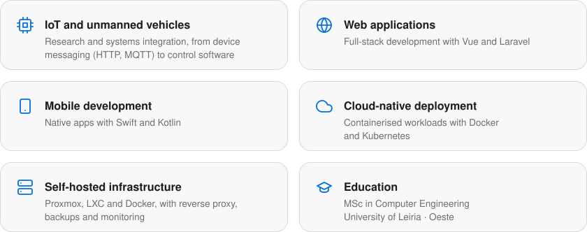

<a href="https://www.linkedin.com/in/pedrobarbeiro/">
<picture>
  <source media="(prefers-color-scheme: dark)" srcset="assets/header-dark.svg">
  
</picture>
</a>

<picture>
  <source media="(prefers-color-scheme: dark)" srcset="assets/chips-dark.svg">
  
</picture>

 

<h2>Focus</h2>

<picture>
  <source media="(prefers-color-scheme: dark)" srcset="assets/focus-dark.svg">
  
</picture>

 

<h2>Tech stack</h2>

<b>LANGUAGES</b>

<picture>
  <source media="(prefers-color-scheme: dark)" srcset="https://skillicons.dev/icons?i=ts%2Cjs%2Cphp%2Cpython%2Ccs%2Cjava%2Cc%2Cswift%2Ckotlin&amp;theme=dark&amp;perline=10">
  
</picture>

<b>WEB AND RUNTIME</b>

<picture>
  <source media="(prefers-color-scheme: dark)" srcset="https://skillicons.dev/icons?i=vue%2Claravel%2Cnodejs&amp;theme=dark&amp;perline=10">
  
</picture>

<b>INFRASTRUCTURE AND TOOLS</b>

<picture>
  <source media="(prefers-color-scheme: dark)" srcset="https://skillicons.dev/icons?i=docker%2Ckubernetes%2Clinux%2Cgit&amp;theme=dark&amp;perline=10">
  
</picture>

 

<a href="https://www.linkedin.com/in/pedrobarbeiro/">
<picture>
  <source media="(prefers-color-scheme: dark)" srcset="assets/footer-dark.svg">
  
</picture>
</a>

